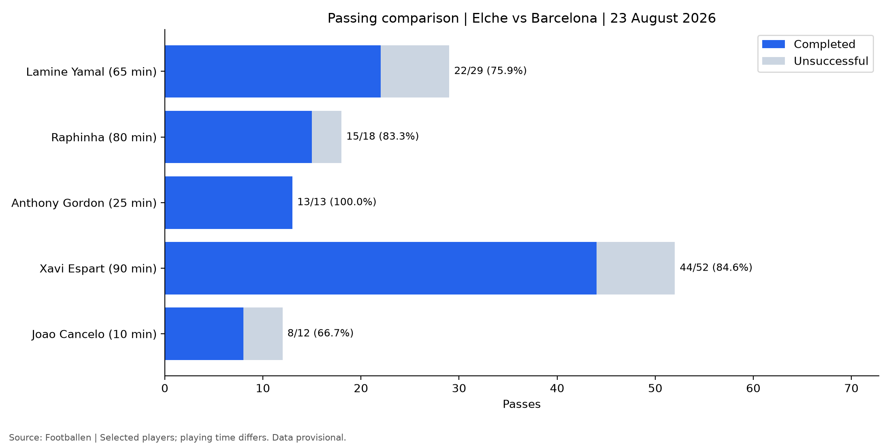
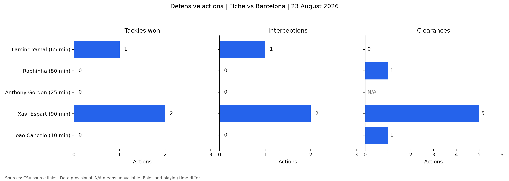
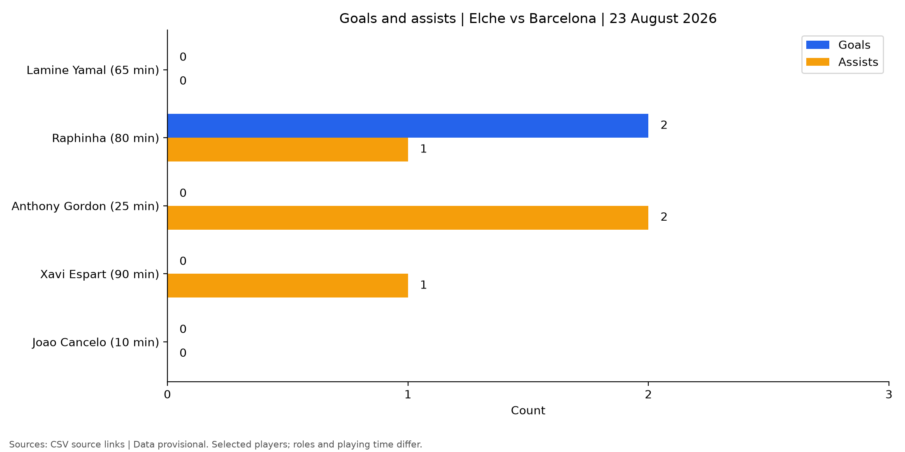

# Barcelona vs Elche: Player Analysis

A Python project comparing five Barcelona players in the Elche match on 23 August 2026.

I created this project to apply my data analysis skills to football, exploring how player contributions can be presented through match statistics.

## Players analysed

- Lamine Yamal
- Raphinha
- Anthony Gordon
- Xavi Espart
- João Cancelo

## What the project does

Reads player statistics from a CSV, calculates accuracy percentages and generates charts covering passing, defensive actions, and goals and assists.

Running the script also opens all three charts side by side in one separate window.

## Findings from the collected data

Raphinha recorded two goals and one assist in 80 minutes. Gordon contributed two assists during his 25-minute appearance and completed all 13 attempted passes.

Espart completed the most passes among the selected players, with 44 from 52 attempts. He also recorded two tackles won and two interceptions.

These observations describe one match. Different positions and playing time affect the comparisons. For example, Gordon's 100% passing accuracy comes from a small sample and does not establish that he was the best passer.

## Charts

### Passing

Completed and unsuccessful passes, with completion percentages and minutes played.



### Defensive actions

Tackles won, interceptions and clearances. Unavailable values display as N/A.



### Goals and assists

Recorded goals and assists for each selected player.



## Run the project

Install the dependencies:

```bash
python -m pip install pandas matplotlib
```

Run the analysis:

```bash
python analysis.py
```

The script prints the player comparison in the terminal and saves the charts in `outputs/`. It then opens a window displaying all three charts side by side. Close that window to finish the script.

## Files

| File | Purpose |
|---|---|
| `analysis.py` | Reads the data, calculates percentages and produces charts |
| `data/player_stats.csv` | Match statistics and source links |
| `outputs/` | Generated PNG charts |

## Calculations

- Passing accuracy = accurate passes ÷ attempted passes × 100
- Shooting accuracy = shots on target ÷ total shots × 100
- Dribble success = completed dribbles ÷ attempted dribbles × 100

Percentages are undefined when there are no attempts and display as N/A.

## Data sources and limitations

This project uses publicly available statistics from Footballen, StatMuse and Global Sports Archive. Source links are recorded in the CSV.

The dataset is provisional. Figures have not all been independently verified against the original data provider, and definitions or models may differ between sources, including xG and xA.

I do not have access to full professional data feeds. Unavailable figures are marked as NA rather than estimated or replaced with zero. Blank substitution fields indicate that no substitution applies.

Minutes follow the displayed substitution timeline and exclude added time.

This is an exploratory analysis of five players in one match. The statistics do not capture every contribution, including positioning and off-ball movement, and should not be used alone to rank overall performance.